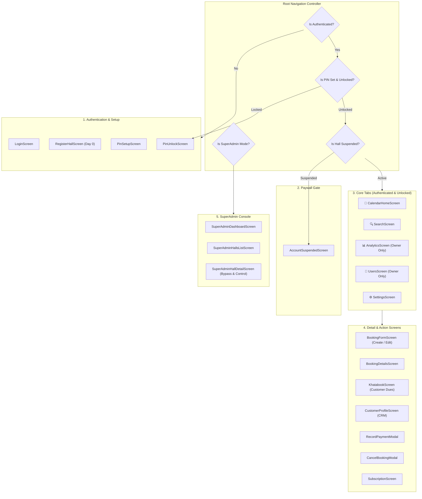

# Aura — Frontend Development Blueprint & Phased Roadmap

This document defines the complete step-by-step roadmap to build the **Aura (Function Hall Booking Management)** mobile application using **React Native (Expo)**, **TypeScript**, **NativeWind (Tailwind CSS)**, and **Supabase**.

---

## Architecture Overview

---

## Phase 1: Foundation, Authentication, Hall Setup & PIN Security

### 1.1 Goal
Establish the core app infrastructure, Supabase client initialization, secure token storage, Day-0 hall onboarding, and fast 4-digit PIN unlock.

### 1.2 Screens to Build
1. **`LoginScreen`**: Username or Email + Password login. Resolves usernames via `resolve_staff_login_email`.
2. **`RegisterHallScreen`**: "Day 0" setup for new owners (Hall Name, Phone, Address, Slot mode). Calls `register_hall_and_owner()`.
3. **`PinSetupScreen`**: Prompted after initial password login to set a 4-digit quick unlock PIN.
4. **`PinUnlockScreen`**: The default daily entry screen. 4-digit keypad for rapid local unlock without re-entering passwords or using OTPs.

### 1.3 Components to Build
* `AuthInput`: Reusable text input with icon, error state, and clear button.
* `PrimaryButton` & `SecondaryButton`: Styled buttons with loading spinners.
* `PinKeypad`: Custom 0-9 numeric pad with backspace button and haptic feedback.
* `PinDots`: Visual 4-dot indicator showing entered digits with shake animation on incorrect PIN.
* `RoleBadge`: Tag displaying `Owner` vs `Staff`.

### 1.4 Backend Hooks & RPCs
* `supabase.auth.signInWithPassword(...)`
* RPC: `register_hall_and_owner(...)`
* RPC: `set_member_pin(p_pin)`
* RPC: `verify_member_pin(p_pin)`
* RPC: `refresh_active_device_session(p_push_token)`
* Hardware SecureStore: `expo-secure-store` for session tokens and PIN hashes.

### 1.5 Verification & Testing Checklist
- [ ] New owner can register an account and successfully provision a hall with a 14-day trial.
- [ ] Setting a 4-digit PIN works and allows quick unlocking on app reopen.
- [ ] Single-device login: Logging in on a second device invalidates the session token on the first device.

---

## Phase 2: Live Calendar & Slot Availability Engine

### 2.1 Goal
Build the main operational dashboard where owners and staff view live bookings, navigate weeks, and see available dates at a glance.

### 2.2 Screens to Build
1. **`CalendarHomeScreen`**: Week-wise calendar view with week/month selector and live updates.

### 2.3 Components to Build
* `SummaryRevenueHeader`: Top cards showing **Expected Revenue** and **Pending Balance** (tap to open Khatabook).
* `LiveSyncIndicator`: Pulsing green indicator showing real-time WebSocket connection to Supabase Realtime.
* `WeekSelector`: Horizontal swipe/arrow controller (e.g. *"Week 2 of 5 — Nov 2026"*).
* `MonthPickerModal`: Quick jump modal to any month in the year.
* `DateRowItem`: Date container (left: Day and Date, right: slot booking cards).
* `SlotCard`: Displays customer name, event type, package, and payment status badge (`Fully Paid`, `Due ₹X`, `Overdue`).
* `FreeSlotPlusCard`: A prominent green **"+" Plus Card**; tapping it opens the Booking Form with the date and slot prefilled.

### 2.4 Backend Hooks & Subscriptions
* Query: `bookings` joined with `booking_financial_summaries` for the 7 days of the selected week.
* Supabase Realtime Channel: `supabase.channel('hall-bookings').on('postgres_changes', { filter: 'hall_id=eq.' + hallId })`.

### 2.5 Verification & Testing Checklist
- [ ] Changing between Two-Slot mode and Full-Day mode correctly renders morning/evening vs full-day blocks.
- [ ] Adding a booking on Device A updates Device B's calendar in real time without refreshing.
- [ ] Tapping the "+" card opens the Booking Form with the exact date prefilled.

---

## Phase 3: Booking Lifecycle, GiST Conflict Engine & Cancellation

### 3.1 Goal
Provide the unified booking form, enforce database-level conflict prevention (zero double bookings), view full booking contracts, and allow owner cancellations with refunds.

### 3.2 Screens to Build
1. **`BookingFormScreen`** *(Create & Edit Unified Form)*:
   * Customer Name & Mobile (auto-completes existing customers).
   * Date range (single day or multi-day).
   * Slot chips (`Morning`, `Evening`, `Full Day`).
   * Package selector (auto-populates default package price, editable for that booking).
   * Extra charges (numeric) + extra charge details notes.
   * Expected guest count & event type.
   * Advance payment input (supports split payment modes: Cash, Card, UPI, Credit).
2. **`BookingDetailsScreen`**: Complete booking sheet showing contract breakdown, payments ledger, customer contact, and action buttons.
3. **`CancelBookingModal`** *(Owner Only)*: Mandatory cancellation reason, refund amount input, and refund payment mode selector.

### 3.3 Components to Build
* `CustomerAutoSuggestInput`: Debounced mobile search auto-filling name if customer exists.
* `SlotChipsGroup`: Morning / Evening / Full-Day selector.
* `PackagePickerDropdown`: Selects from active hall packages.
* `SplitPaymentInput`: Dynamic rows allowing split advance payments (e.g., ₹30k UPI + ₹20k Credit).
* `BookingStatusBadge`: Badges for `Confirmed`, `Cancelled`, `Paid`, `Overpaid`, `Overdue`.

### 3.4 Backend Hooks & RPCs
* RPC: `create_booking_atomic(...)`
* RPC: `edit_booking_atomic(...)`
* RPC: `cancel_booking(...)`

### 3.5 Verification & Testing Checklist
- [ ] Attempting to book an already occupied slot triggers a clean conflict warning naming the existing booking.
- [ ] Staff editing a booking's price triggers an audit log and owner notification alert.
- [ ] Cancelling a booking (owner only) immediately frees up the calendar slot and records the refund in the ledger.
- [ ] Calling cancel on an already cancelled booking is blocked.

---

## Phase 4: Financial Ledger, Khatabook & WhatsApp Invoicing

### 4.1 Goal
Track customer balances, flag overdue accounts, record subsequent and split payments, reverse wrong payments with an immutable audit trail, and share bills over WhatsApp.

### 4.2 Screens to Build
1. **`KhatabookScreen`**: Dues management opened from the Calendar "Pending Balance" card. Shows all bookings with an outstanding balance.
2. **`RecordPaymentModal`**: Add subsequent payments to an existing booking.
3. **`PaymentReversalModal`**: Correct a mistakenly entered payment with a mandatory reason.

### 4.3 Components to Build
* `KhatabookCard`: Shows Customer Name, Event Date, Bill Number, Total Contract, Total Paid, and Remaining Due.
* `KhatabookFilterChips`: Filter tabs (`All`, `Overdue`, `Upcoming`, `Credit`).
* `WhatsAppShareButton`: Generates prefilled WhatsApp text bill with payment link.
* `PaymentLedgerItem`: Row showing amount, payment mode, date, staff recorder, and reversal status.

### 4.4 Backend Hooks & RPCs
* View: `booking_financial_summaries`
* RPC: `record_payment(...)`
* RPC: `reverse_payment(...)`
* Client helper: `generateWhatsAppBillUrl(bookingData)`

### 4.5 Verification & Testing Checklist
- [x] Events in the past with unpaid balance automatically display the red **OVERDUE** badge.
- [x] Recording a credit payment saves a `promised_pay_by_date`.
- [x] Reversing a payment creates a visible correction entry without deleting the original row.
- [x] Reversing the same payment twice is rejected by the database.
- [x] Tapping "Share on WhatsApp" opens WhatsApp with the formatted bill summary.

---

## Phase 5: Staff Management & Hall Settings

### 5.1 Goal
Allow hall owners to manage staff accounts (up to the 5-member limit), configure per-screen permissions, manage hall details, slot timings, and packages.

### 5.2 Screens to Build
1. **`UsersScreen`** *(Owner Only)*: Staff directory, active team counter (`3 of 5 active`), and staff invite/creation.
2. **`AddStaffModal`**: Username, Password, and per-screen permission toggles.
3. **`SettingsScreen`**:
   * Hall Profile: Name, Phone, Address, GST Number, Bill Prefix (`AURA-`).
   * Slot Timings: Morning start/end, Evening start/end.
   * Slot Toggles: Two-Slot mode toggle, Multi-Day booking toggle.
   * Package Management: Add/edit packages with prices and amenities.
   * Notification Settings: Price change alerts, cancellation alerts, reversal alerts.

### 5.3 Components to Build
* `TeamLimitCounter`: Progress bar showing active members vs the 5-member maximum.
* `StaffCard`: Shows staff username, permissions list, reset password button, and remove button.
* `PermissionToggleSwitch`: Toggle switches for `Calendar`, `Search`, `Khatabook`, `Analytics`, `Users`, `Settings`.
* `PackageCard`: Displays package name, price, and amenity chips with edit/delete buttons.
* `TimePickerInput`: Native time picker for morning/evening slot hours.

### 5.4 Backend Hooks & Functions
* Edge Function: `create-staff` (uses Supabase Admin API with deterministic shadow email).
* RPC: `current_member()` (enforces client-side screen hiding based on database permissions).
* Trigger: `enforce_max_hall_members` (database-level lock preventing > 5 members).

### 5.5 Verification & Testing Checklist
- [x] Owner can create a staff account; staff can log in using just their username and password via `create-staff` Edge Function.
- [x] Attempting to add a 6th team member is blocked by database trigger & UI counter disabled state.
- [x] Logging in as staff hides unauthorized tabs (e.g. Analytics, Users, Settings).
- [x] Updating morning/evening slot timings applies to new bookings and persists to `halls` table.
- [x] Packages catalog wired to live PostgreSQL `packages` CRUD with soft-deletes (`is_active = false`).

---

## Phase 6: Sub-Millisecond Search & Owner Analytics

### 6.1 Goal
Empower owners and staff to search across thousands of customer records in sub-milliseconds, provide owners with revenue, occupancy, and package analytics, and streamline staff onboarding with instant credential sharing.

### 6.2 Screens & Modals to Build
1. **`SearchScreen`**: Real-time search across customer names, mobile numbers, and bill numbers.
2. **`CustomerProfileScreen`**: Light CRM card showing lifetime events booked, total money paid, and balance history.
3. **`AnalyticsScreen`** *(Owner Only)*: Comprehensive financial and operational reports.
4. **`StaffCredentialsSuccessModal`** *(Staff Onboarding)*: Post-creation modal in `UsersScreen` showing newly generated login credentials (Hall Phone, Staff Username, Temporary Password) with a 1-tap **"Copy Credentials"** button and WhatsApp share option for the owner to send directly to staff.

### 6.3 Components to Build
* `SearchInput`: Fast debounced input with clear button.
* `CustomerSearchResultCard` & `BookingSearchResultCard`: Distinct visual result cards.
* `DateRangePickerModal`: Presets (`This Month`, `Last Month`, `This Year`) + Custom Date Picker.
* `AnalyticsMetricCard`: Displays Contract Expected, Net Cash Collected, Pending Dues, Cancellations.
* `TopEventsBarChart` & `TopPackagesList`: Visual breakdown of most popular event types and packages.
* `PdfExportButton`: Generates printable PDF summary of the analytics period.
* `CredentialsCopyCard`: 1-tap clipboard copy component formatting login instructions (Hall Phone + Username + Password) for staff.

### 6.4 Backend Hooks & RPCs
* Trigram GIN Search: `customers` table using `pg_trgm` operators (`name ILIKE %query%`, `mobile ILIKE %query%`).
* RPC: `get_hall_analytics(p_start_date, p_end_date)`.

### 6.5 Verification & Testing Checklist
- [ ] Partial substring search (e.g. "9876" or "Sha") returns results instantly without full table scans.
- [ ] Analytics numbers share a consistent date basis: pending dues match actual booking balances for the period.
- [ ] Staff accounts attempting to access the Analytics tab receive access denied.

---

## Phase 7: Subscriptions, Paywall & SuperAdmin Console (With Bypass)

### 7.1 Goal
Manage SaaS monetization, enforce automated trial/plan expiration paywalls, and provide a master SuperAdmin console with the ability to **bypass subscriptions for VIP/partner halls**.

### 7.2 Screens to Build
1. **`SubscriptionScreen`**: Current plan status badge, trial countdown timer, annual upgrade pricing cards (₹4,499 & ₹7,999), and UPI payment link.
2. **`AccountSuspendedScreen`** *(Hard Paywall Gate)*: Blocks app usage when a trial or grace period lapses, reassuring owners that their data is safe and providing an instant reactivation link.
3. **`SuperAdminDashboardScreen`**: Global metrics (Total Registered Halls, Active Paid Plans, ARR, Total Platform GMV, 30-Day Renewals).
4. **`SuperAdminHallsListScreen`**: Directory of all halls across India with search and status filters (`Trial`, `Active`, `Grace Period`, `Suspended`).
5. **`SuperAdminHallDetailScreen`**: Hall management controls:
   * Activate 1-Year Standard Plan.
   * Extend Trial (+7 or +14 Days).
   * **Subscription Bypass Toggle ("Lifetime Free Access / Partner Bypass")**: Completely exempts the hall from subscription checks.
   * Emergency Owner Password/PIN Reset.
   * **"View As Hall" Mode**: Read-only live calendar support mode.

### 7.3 Components to Build
* `PlanCard`: Pricing cards highlighting the Standard ₹7,999/yr plan.
* `PaywallBanner`: Persistent top banner during the 7-day grace period.
* `SuperAdminMetricCard`: Global financial summary cards.
* `SubscriptionBypassSwitch`: Toggle switch in SuperAdmin detail screen: *"Exempt from Subscription"*.
* `ImpersonateHeader`: Yellow top bar indicating: *"Viewing as Support — Read-Only Mode"*.

### 7.4 Backend Hooks & RPCs
* RPC: `superadmin_get_platform_metrics()`
* RPC: `superadmin_update_subscription(...)`
* RPC: `superadmin_toggle_suspension(...)`
* Database column: `halls.is_subscription_exempt BOOLEAN DEFAULT false` (Bypass flag).

### 7.5 Verification & Testing Checklist
- [ ] When a hall's subscription expires, the app gates entry behind the `AccountSuspendedScreen`.
- [ ] Toggling the **Subscription Bypass** in SuperAdmin immediately unlocks the hall without requiring payment.
- [ ] SuperAdmin can view any hall's calendar in read-only mode to assist over the phone.
- [ ] Global metrics (ARR & GMV) update accurately in the SuperAdmin dashboard.

---

## Summary Matrix of All 7 Phases

| Phase | Core Deliverable | Screen Count | Key Backend Integration |
| :---: | :--- | :---: | :--- |
| **1** | Auth, Onboarding & PIN Security | 4 | `register_hall_and_owner`, PIN Blowfish hash, Single-Device Token |
| **2** | Live Calendar & Realtime Slots | 1 | Supabase Phoenix Realtime, Two-slot vs Full-day logic |
| **3** | Bookings, Conflict Prevention & Cancellation | 3 | PostgreSQL GiST Exclusion (`tstzrange`), Owner refund modal |
| **4** | Financial Ledger, Khatabook & WhatsApp Bills | 3 | Immutable payments, Reversals, Overdue logic, WhatsApp link |
| **5** | Staff Management & Hall Settings | 2 | `create-staff` Edge Function, 5-member limit trigger, Screen RLS |
| **6** | Fast Customer Search & Owner Analytics | 3 | `pg_trgm` GIN search, `get_hall_analytics` RPC |
| **7** | Subscriptions, Paywall & SuperAdmin Console | 5 | Paywall gate, Platform ARR/GMV metrics, Subscription Bypass |
| **TOTAL** | **Full Commercial Platform** | **21 Screens** | **Production-Ready Multi-Tenant Architecture** |

